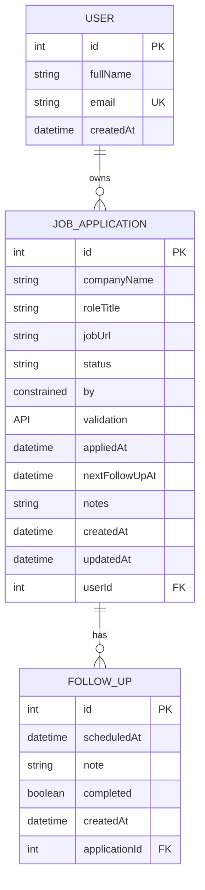

# ApplyTrail ERD

## Relationships and integrity
- One **User** can own zero or many **JobApplication** records; each application belongs to one user.
- One **JobApplication** can have zero or many **FollowUp** records; each follow-up belongs to one application.
- Deleting a user cascades to the user's applications; deleting an application cascades to its follow-ups.
- `User.email` is unique. Indexes support filtering applications by user and status, and retrieving follow-ups by application.

## Field decisions
- `status` is stored as a string in SQLite and constrained by request validation to `SAVED`, `APPLIED`, `SCREENING`, `INTERVIEW`, `OFFER`, `REJECTED`, or `WITHDRAWN`; this keeps local SQLite development compatible while preventing unsupported status values at the API boundary.
- `jobUrl`, `nextFollowUpAt`, and `notes` are optional because a user may save a role before applying or may not need a follow-up.
- Timestamps are stored as DateTime values. `createdAt` and `updatedAt` support basic history and debugging.
- Week 1 uses a seeded demo user ID in create requests. Week 2 will add authentication and derive ownership from the logged-in user instead of trusting client-provided ownership.
